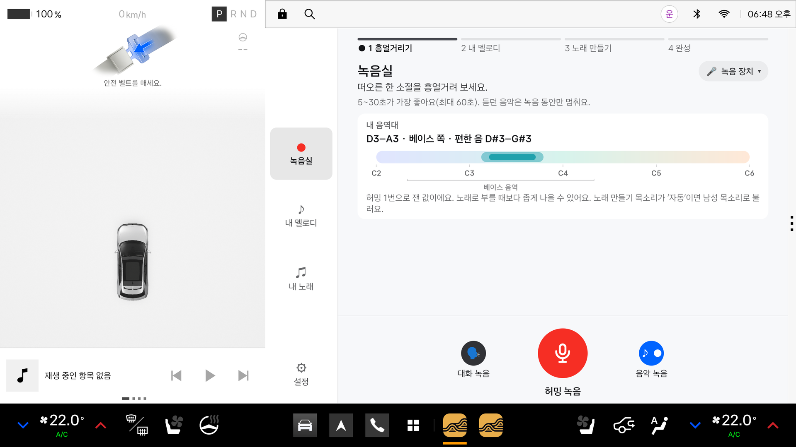
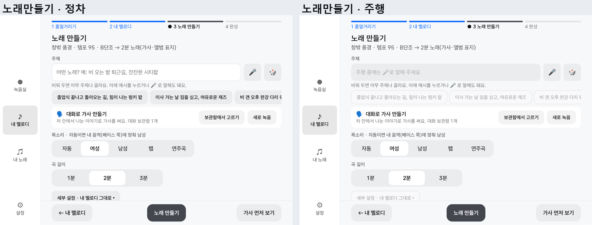
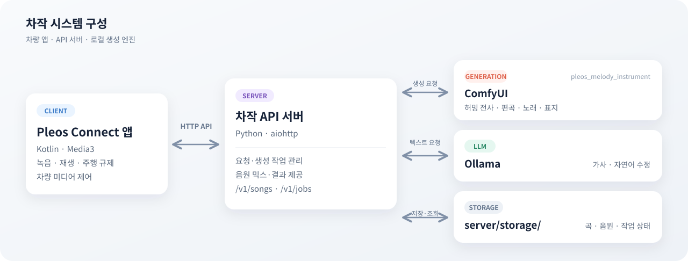

#  CHAJAK | 차작 (차구석 작곡가)


**운전 중 흥얼거린 멜로디를 나만의 노래로 만드는 Pleos Connect 차량용 앱.**

2026 [현대자동차그룹 차량용 앱 개발 공모전](https://appdevchallenge.auto-hmg.io/guide/overview) 출품작

## APK 설치와 확인

[제출 APK](app/apk/chajak-0.4.11-drive.apk)를 설치해 앱을 확인합니다. 서버와 모델은 저희가 운영하는 호스트 PC에서 심사 기간 내내 켜 두고, 제출 APK에 그 서버 주소와 접근 토큰이 들어 있습니다. **심사위원은 APK만 설치하면 되고, 서버나 모델을 설치할 필요가 없습니다.**

| 항목 | 내용 |
| --- | --- |
| 앱 이름 | 차작 (차구석 작곡가) |
| 설치 파일 | [`app/apk/chajak-0.4.11-drive.apk`](app/apk/chajak-0.4.11-drive.apk) |
| 확인 환경 | Pleos Connect 에뮬레이터 v2.1.0, Android API 34 (Android Automotive) |
| 운영 서버 | Windows 11 · NVIDIA RTX 5070 Ti 16GB · Python 3.10 · ComfyUI · Ollama ([구성](docs/server-setup.md)) |
| 권장 화면 | 2560 × 1440 px, 160 dpi |
| 필요한 설정 | 인터넷 연결, 에뮬레이터의 호스트 마이크 입력 활성화, 앱의 녹음 권한 허용 |

1. [Pleos Connect 에뮬레이터 가이드](https://document.pleos.ai/docs/connect/guide/getting-started/application-development/setup-connect-sdk-emulator)에 따라 에뮬레이터를 실행합니다. 녹음을 확인하려면 호스트 마이크를 연결하고 **Virtual microphone uses host audio input**을 켭니다.
2. APK를 설치하고 앱을 시작합니다.

   ```bash
   adb install -r --user 10 app/apk/chajak-0.4.11-drive.apk
   adb shell am start --user 10 -n ai.sonon.chajak/.MainActivity
   ```

3. 녹음을 허용하고 앱을 사용합니다. 서버 연결 상태는 앱 **⚙ 설정 → 서버 연결**에서 확인할 수 있습니다.

제출 APK에는 **운영 서버 주소(터널)와 접근 토큰**이 기본값으로 들어 있어 주소를 바꿀 필요가 없습니다. 노래 한 곡은 곡 길이에 따라 3~5분쯤 걸리고, 앱이 진행 상황을 보여 줍니다.

서버를 직접 실행해 시험할 때는 [호스트 서버 설치·실행 가이드](docs/server-setup.md)대로 서버를 켠 뒤, 정차 중에 **⚙ 설정 → 서버 연결**에서 주소를 `http://10.0.2.2:8790`(에뮬레이터를 실행한 PC)으로 바꿉니다.

## 앱 사용 흐름




| 화면 | 하는 일 |
| --- | --- |
| **녹음실** | 가운데 큰 버튼으로 **허밍 녹음**(5~30초). 차 안 이야기를 담는 **대화 녹음**, 듣던 음악에서 멜로디를 따는 **음악 녹음**. 내 음역대를 막대로 보여 줌 |
| **녹음 원본** | 대화·음악 녹음 보관함. 다시 듣기, 파일로 저장, 멜로디로 만들기 |
| **내 멜로디** | 허밍을 음표와 피아노 연주로 바꾸고 원본 허밍과 비교. 멜로디 완성하기 · AI로 멜로디 살리기 · 위/아래 화음 |
| **노래 만들기** | 주제(말로 말하거나 예시 고르기), 대화로 가사 만들기, 목소리(자동·여성·남성·랩·연주곡), 길이 1~3분, 내 멜로디를 **그대로 / AI가 다듬기 / AI가 새로**. 가사 먼저 보기, 만드는 중 **하나 더(대기열)** |
| **내 노래** | 완성곡을 만든 드라이브(출근길·퇴근길·밤…)별 앨범으로 묶어 타일·리스트로 보기 |
| **노래 듣기** | 표지·가사와 함께 재생, 말로 바꿔 새 버전, AI 제안, 세부 설정으로 다시 만들기 |

주행 중에는 글자 입력·지우기·설정 변경을 막고 말로 입력하게 하며, 녹음은 버튼 하나로 계속할 수 있습니다. 재생은 차량 미디어 센터의 재생 제어와 연결됩니다.



완성곡의 앨범 표지는 AI가 노래 주제에 맞춰 글자 없이 그립니다.


## 구성과 개발 자료



| 경로 | 역할 |
| --- | --- |
| [`app/`](app/) | Android 앱 소스와 제출 APK |
| [`server/`](server/) | 호스트 API와 생성 작업 관리 |
| [`comfyui-node/pleos_melody_instrument/`](comfyui-node/pleos_melody_instrument/) | ComfyUI 생성 노드 |
| [`tests/`](tests/) | 서버 기능·API 시험 |

서버 운영자는 [호스트 서버 설치·실행 가이드](docs/server-setup.md)를 참고합니다. 앱을 직접 빌드할 때는 JDK 17과 Android SDK Platform 36이 필요하며, `app/`에서 `./gradlew assembleDebug`를 실행합니다.

## 라이선스와 데이터

YuE2는 비상업용 **CC BY-NC** 라이선스의 시연용 생성 엔진입니다. **AI가 새로**를 고른 노래는 선택 외부 API인 Mureka로 만들 수 있으며, 키가 없거나 한도·오류로 실패하면 YuE2로 자동 전환합니다. 사용자 녹음과 생성 곡은 호스트의 `server/storage/`에 저장되며 제출 저장소에 포함하지 않습니다.
