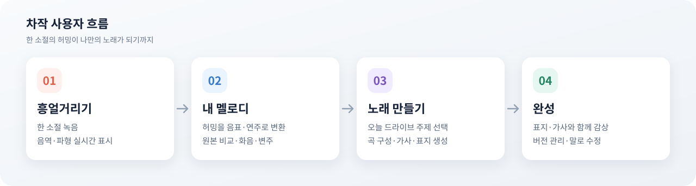

# CHAJAK | 차작 (차구석 작곡가)


**운전 중 흥얼거린 멜로디를 나만의 노래로 만드는 Pleos Connect 차량용 앱.**

2026 [현대자동차그룹 차량용 앱 개발 공모전](https://appdevchallenge.auto-hmg.io/guide/overview) 출품작

## APK 설치와 확인

심사위원은 [제출 APK](app/apk/chajak-0.4.11-drive.apk)를 설치해 앱을 확인합니다. 서버와 모델은 호스트 서버에서 운영하며 심사 기기에 설치할 필요가 없습니다.

| 항목 | 내용 |
| --- | --- |
| 앱 이름 | 차작 (차구석 작곡가) |
| 설치 파일 | [`app/apk/chajak-0.4.11-drive.apk`](app/apk/chajak-0.4.11-drive.apk) |
| 확인 환경 | Pleos Connect 에뮬레이터 v2.1.0, Android API 34 |
| 권장 화면 | 2560 × 1440 px, 160 dpi |
| 필요한 설정 | 호스트 PC에서 서버 실행, 에뮬레이터의 호스트 마이크 입력 활성화, 앱의 녹음 권한 허용 |

1. [Pleos Connect 에뮬레이터 가이드](https://document.pleos.ai/docs/connect/guide/getting-started/application-development/setup-connect-sdk-emulator)에 따라 에뮬레이터를 실행합니다. 녹음을 확인하려면 호스트 마이크를 연결하고 **Virtual microphone uses host audio input**을 켭니다.
2. APK를 설치하고 앱을 시작합니다.

   ```bash
   adb install -r --user 10 app/apk/chajak-0.4.11-drive.apk
   adb shell am start --user 10 -n ai.sonon.chajak/.MainActivity
   ```

3. 녹음을 허용하고 앱을 사용합니다. 서버 연결 상태는 앱 **⚙ 설정 → 서버 연결**에서 확인할 수 있습니다.

제출 APK에는 **`http://10.0.2.2:8790`**이 기본 서버 주소로 들어 있습니다. Pleos Connect 에뮬레이터에서 `10.0.2.2`는 에뮬레이터를 실행하는 호스트 PC를 가리키므로, 해당 PC에서 서버가 실행 중이면 주소 변경 없이 곡 생성 기능을 사용할 수 있습니다.

## 앱 사용 흐름



녹음한 허밍을 악보와 악기 연주로 확인하고, 멜로디 변주를 더한 뒤 가사·표지가 있는 노래를 만듭니다. 앱은 주행 중 녹음과 글자 입력을 제한하며, 차량 미디어 센터와 재생 제어를 연결합니다.

## 구성과 개발 자료


| 경로 | 역할 |
| --- | --- |
| [`app/`](app/) | Android 앱 소스와 제출 APK |
| [`server/`](server/) | 호스트 API와 생성 작업 관리 |
| [`comfyui-node/pleos_melody_instrument/`](comfyui-node/pleos_melody_instrument/) | ComfyUI 생성 노드 |
| [`tests/`](tests/) | 서버 기능·API 시험 |

서버 운영자는 [호스트 서버 설치·실행 가이드](docs/server-setup.md)를 참고합니다. 앱을 직접 빌드할 때는 JDK 17과 Android SDK Platform 36이 필요하며, `app/`에서 `./gradlew assembleDebug`를 실행합니다.

## 라이선스와 데이터

YuE2는 비상업용 **CC BY-NC** 라이선스의 시연용 생성 엔진입니다. 사용자 녹음과 생성 곡은 호스트의 `server/storage/`에 저장되며 제출 저장소에 포함하지 않습니다.
